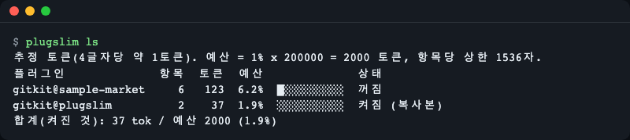
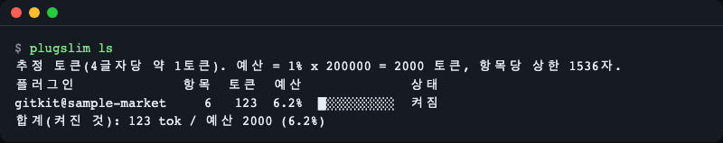
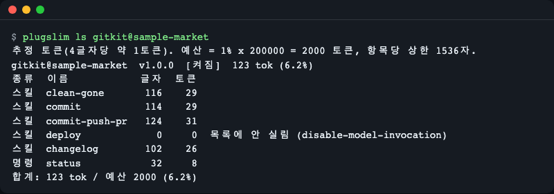
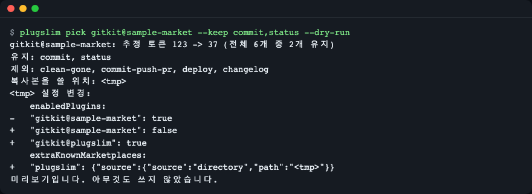
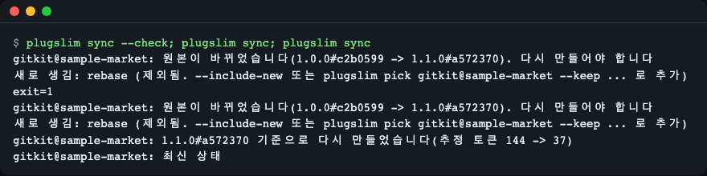
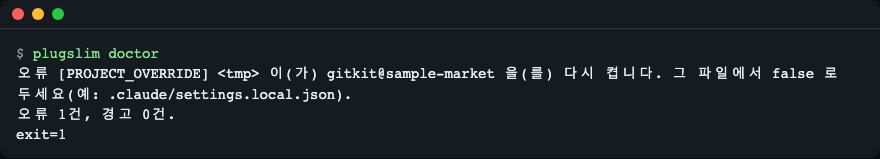

# plugslim

[English](README.md) | **한국어**

Claude Code 플러그인에서 실제로 쓰는 스킬만 남기고, 매 턴 실리는 스킬 목록의 토큰 비용을 숫자로 보여 주는 도구입니다. `plugslim pick` 은 선택한 스킬만 담은 가벼운 복사본을 만들고, 공식 로컬 디렉터리 마켓플레이스와 `enabledPlugins` 설정으로 그 복사본을 켭니다. 런타임을 건드리지 않고, `plugslim restore` 로 되돌릴 수 있습니다.


*pick 뒤의 `plugslim ls`: 원본 플러그인은 꺼짐(123 tok), 가벼운 복사본은 켜짐(37 tok, 목록 예산의 1.9%). 숫자는 실제 플러그인이 아니라 연습용 샘플에서 나온 값입니다.*

## 이런 분께

- 스킬이 많은 플러그인을 설치했지만 두세 개만 쓰는 분
- 같은 플러그인의 비슷한 이름 스킬이 자꾸 엉뚱하게 호출되는 분
- 플러그인을 만들면서 스킬 목록 비용이 커지면 CI 에서 실패하게 하고 싶은 분

## 왜 필요한가

Claude Code 는 플러그인을 통째로만 켜고 끕니다. 켜진 스킬은 이름과 설명이 매 턴 함께 보내는 스킬 목록에 들어가므로, 쓰지 않는 스킬도 컨텍스트를 차지합니다. `skillOverrides` 설정은 플러그인 스킬에는 적용되지 않습니다([스킬 문서](https://code.claude.com/docs/en/skills.md), 2026-11-15 확인). plugslim 은 공식 기능만 써서 이를 우회합니다. 고른 스킬만 든 플러그인 복사본을 만드는 방식입니다.

## 설치

Node.js 22 이상이 필요합니다(`brew install node`, 또는 [nodejs.org](https://nodejs.org/)). 최소 리눅스 이미지에서는 GitHub 설치를 위해 `git` 도 필요합니다.

```bash
npm install -g github:LeeGyeongPil/plugslim
```

설치 없이 한 번만 실행하려면: `npx github:LeeGyeongPil/plugslim ls`.

## 빠르게 시작하기

먼저 **연습용 샘플**로 해 보세요. `examples/sample-home/.claude` 에 있는 가짜 플러그인이며 실제 Claude Code 설정이 아닙니다. 아래 명령은 이 샘플을 읽기만 합니다. 저장소를 받아 의존성을 설치합니다(컴파일된 `dist/` 가 커밋돼 있어 빌드는 필요 없습니다).

```bash
git clone https://github.com/LeeGyeongPil/plugslim.git && cd plugslim
npm install
```

```console
$ plugslim ls --config-dir examples/sample-home/.claude
추정 토큰(4글자당 약 1토큰). 예산 = 1% x 200000 = 2000 토큰, 항목당 상한 1536자.
플러그인              항목  토큰  예산              상태
gitkit@sample-market     6   123  6.2%  █░░░░░░░░░  켜짐
합계(켜진 것): 123 tok / 예산 2000 (6.2%)
```

(클론 안에서는 `plugslim ...` 대신 로컬 빌드인 `node dist/bin.js ...` 로 실행합니다.) 이 플러그인은 매 턴 약 123 토큰을 씁니다. 내 플러그인을 보려면 `--config-dir` 없이 `plugslim ls` 를 실행하세요.


*플러그인 표: 항목 수, 추정 토큰, 예산 대비 비율.*

내 설정에서의 다섯 단계는 이렇습니다.

1. Claude Code 에서 `/skill-doctor` 를 실행해 쓰지 않는 스킬을 확인합니다. 그 스킬은 빼고, 남길 스킬은 `--keep` 에, 빼려는 스킬은 `--drop` 에 `plugslim ls <plugin-id>` 가 보여 주는 접두 없는 이름 또는 `/skill-doctor` 에 보이는 `<plugin>:<skill>` 이름으로 넣습니다(공식 [문서](https://code.claude.com/docs/en/skills.md#find-unused-skills)의 "Find unused skills" 에 따르면 Claude Code v2.1.252 이상 필요, 2026-11-16 확인, 선택 단계).
2. `plugslim ls` 로 토큰이 어디서 나가는지 봅니다.
3. `plugslim pick <plugin-id> --keep a,b --dry-run` 으로 무엇이 바뀔지 봅니다. 아무것도 쓰지 않습니다.
4. `plugslim pick <plugin-id> --keep a,b` 로 실제로 적용합니다.
5. 새 세션을 시작하거나 `/reload-plugins` 를 실행합니다.

### 안전하게 해 보기: `npm run demo`

데모는 샘플을 임시 폴더로 복사해 ls, pick(미리보기와 실제), doctor, restore 를 실행하고 폴더를 지웁니다. 연습용(mock) 모드라 실제 `~/.claude` 는 건드리지 않고 API 키도 필요 없습니다. 실제 모드와 다른 점은 하나입니다. 실제 모드는 내 설정 파일을 (백업과 함께) 고치고, 변화는 다음 Claude Code 세션에서만 보이는데 데모는 세션을 띄울 수 없습니다.

```console
$ npm run demo
...
--- 요약 ---
이전:   123 tok (추정)
이후:   37 tok (추정)
복원:   예 (123 tok, 설정과 복사본이 원래대로 돌아왔습니다)
```

(위는 한국어 화면 기준입니다. `PLUGSLIM_LANG=en` 이면 영어로 나옵니다.)

## 사용법

| 명령 | 하는 일 | 예 |
|---|---|---|
| `ls [plugin-id]` | 플러그인별, 또는 한 플러그인의 스킬별 추정 목록 비용 | `plugslim ls gitkit@sample-market` |
| `ls --json` | 기계가 읽는 출력(`plugins[].items[]`, `totalTokens`) | `plugslim ls --json` |
| `ls --path <dir>` | 플러그인 폴더를 직접 측정(플러그인 제작자용) | `plugslim ls --path . --max-tokens 800` |
| `pick <id> --keep a,b` / `--drop c` | 가벼운 복사본을 만들고 바꿔 켬 (접두 없는 이름 또는 `<plugin>:<skill>`) | `plugslim pick gitkit@sample-market --keep commit,status` |
| `pick ... --dry-run` | 설정 diff 와 전후 토큰만 출력, 쓰지 않음 | 아래 참고 |
| `sync [id]` | 원본이 업데이트된 뒤 같은 선택을 다시 적용 | `plugslim sync --check` |
| `restore [id \| --all]` | 설정 키를 되돌리고 복사본 삭제 | `plugslim restore gitkit@sample-market` |
| `doctor` | 선택을 되돌리거나 깨뜨리는 설정 점검 | `plugslim doctor --project-dir .` |

종료 코드: `0` 정상, `1` 점검 결과 있음(doctor 오류, `--max-tokens` 초과, `sync --check` 에서 다시 만들어야 함), `2` 사용법·입력 오류.

### 스킬별 비용

```console
$ plugslim ls gitkit@sample-market --config-dir examples/sample-home/.claude
추정 토큰(4글자당 약 1토큰). 예산 = 1% x 200000 = 2000 토큰, 항목당 상한 1536자.
gitkit@sample-market  v1.0.0  [켜짐]  123 tok (6.2%)
종류  이름            글자  토큰
스킬  clean-gone       116    29
스킬  commit           114    29
스킬  commit-push-pr   124    31
스킬  deploy             0     0  목록에 안 실림 (disable-model-invocation)
스킬  changelog        102    26
명령  status            32     8
합계: 123 tok / 예산 2000 (6.2%)
```


*스킬마다 한 줄입니다. `disable-model-invocation` 스킬은 목록에 실리지 않아 0 으로 셉니다.*

### 미리 보고, 적용하기

```console
$ plugslim pick gitkit@sample-market --keep commit,status --dry-run --config-dir <샘플 복사본> --store-dir <store>
gitkit@sample-market: 추정 토큰 123 -> 37 (전체 6개 중 2개 유지)
유지: commit, status
제외: clean-gone, commit-push-pr, deploy, changelog
복사본을 쓸 위치: <store>/marketplace/plugins/gitkit
<config-dir>/settings.json 설정 변경:
    enabledPlugins:
-   "gitkit@sample-market": true
+   "gitkit@sample-market": false
+   "gitkit@plugslim": true
    extraKnownMarketplaces:
+   "plugslim": {"source":{"source":"directory","path":"<store>/marketplace"}}
미리보기입니다. 아무것도 쓰지 않았습니다.
```


*미리보기는 아무것도 쓰기 전에 정확한 설정 변경을 보여 줍니다.*

### 플러그인 업데이트 따라가기

원본 플러그인이 업데이트되면 `sync` 가 새 버전으로 복사본을 다시 만들고 내 선택을 유지합니다. 새 스킬은 `--include-new` 를 주지 않으면 제외됩니다.


*`sync --check` 는 다시 만들어야 하면 종료 코드 1 을 냅니다. 새 `rebase` 스킬은 제외로 보고됩니다. 두 번째 `sync` 는 "최신"이라고 답합니다.*

### 충돌 점검


*`doctor` 가 원본 플러그인을 다시 켜는 프로젝트 설정 파일을 찾았습니다. 그대로 두면 둘 다 로드됩니다. 종료 코드는 1 입니다.*

## 플러그인 제작자용

항상 실리는 목록이 너무 커지면 CI 를 실패시킵니다.

```console
$ plugslim ls --path examples/sample-home/.claude/plugins/cache/sample-market/gitkit/1.0.0 --max-tokens 50 --config-dir examples/sample-home/.claude
...
상시 목록 비용 123 tok 이(가) --max-tokens 50 를 넘었습니다.
$ echo $?
1
```

## 설정

| 설정 | 의미 | 기본값 |
|---|---|---|
| `--lang en\|ko`, `PLUGSLIM_LANG` | 출력 언어. 우선순위: `--lang`, `PLUGSLIM_LANG`, `LC_ALL`, `LC_MESSAGES`, `LANG`. 한국어가 아니면 영어 | 영어 |
| `--store-dir`, `PLUGSLIM_HOME` | 복사본·`state.json`·설정 백업을 두는 폴더 | `~/.plugslim` |
| `--config-dir`, `CLAUDE_CONFIG_DIR` | Claude Code 설정 폴더(읽기. `pick`/`restore` 가 고치는 것은 `settings.json` 뿐) | `~/.claude` |
| `--context-window N` | 예산 계산에 쓰는 컨텍스트 윈도우 | 200000 |
| `--marketplace-name` | 복사본 마켓플레이스 이름(예약된 이름은 거부) | `plugslim` |

한국어로 실행: `plugslim ls --lang ko` 또는 `PLUGSLIM_LANG=ko plugslim ls`.

## 동작 원리


1. 설치된 플러그인 폴더를 복사하고(심볼릭 링크는 실제 파일로 풀어 캐시가 정리돼도 복사본이 깨지지 않게 합니다), 고르지 않은 스킬과 명령을 지웁니다.
2. 매니페스트 경로가 지워진 폴더를 가리키지 않는지 검사합니다.
3. 복사본을 `plugslim` 이라는 로컬 디렉터리 마켓플레이스로 등록하고, 원본·복사본의 `enabledPlugins` 와 `extraKnownMarketplaces.plugslim` 만 바꿉니다. pick 직전 값을 기록해 두어 `restore` 가 정확히 그 값만 되돌립니다.
4. 훅·스크립트 같은 스킬이 아닌 파일은 그대로 복사합니다.

### 숫자는 어떻게 추정하나

목록의 항목은 한 줄, `- <plugin>:<name>: <description + when_to_use>` 이고 글은 1536자까지만 셉니다. 토큰은 `ceil(글자 수 / 4)`, 예산은 컨텍스트 윈도우의 1%(200000 이면 2000)로, [설정 문서](https://code.claude.com/docs/en/settings-reference.md)의 기본값입니다. 이 값들은 **추정**입니다. 한 번 확인했을 때 공식 `claude plugin details` 는 샘플 플러그인을 약 118 토큰, 가벼운 복사본을 약 35 토큰으로 보고했고 plugslim 은 123 과 37 으로 추정했습니다(2026-11-15 확인, Claude Code 2.1.322).

## 언제 쓰나

- 잘 맞는 경우: 일부만 쓰는 플러그인의 부담을 되돌릴 수 있게 줄이고 싶을 때, 또는 내 플러그인의 CI 용 숫자가 필요할 때
- 다른 도구: 플러그인을 통째로 끄려면 Claude Code 의 `/plugin` 메뉴, 플러그인이 아닌 내 스킬은 기본 `skillOverrides` 설정([문서](https://code.claude.com/docs/en/skills.md))
- `/skill-doctor` 와 함께: 어떤 스킬을 쓰는지 보여 줍니다([문서](https://code.claude.com/docs/en/skills.md)). 줄이는 일은 plugslim 이 맡아 플러그인 안에서 고른 스킬만 남기고, 위의 `/plugin` 메뉴는 플러그인을 통째로 켜거나 끕니다.
- 한계: 지금은 사용자 범위 플러그인만 다룹니다. `--scope local|project` 는 계획 중입니다.

## 자주 겪는 문제

| 증상 | 원인 | 해결 |
|---|---|---|
| `settings.json 을(를) JSON 으로 읽을 수 없습니다` 와 종료 코드 2 | 설정의 JSON 이 잘못됨 | 파일을 고치세요. plugslim 은 아무것도 쓰지 않았습니다 |
| pick 뒤에도 `ls` 에 원본이 켜져 있음 (`ls` 는 현재 폴더 또는 `--project-dir` 의 프로젝트·로컬 설정도 반영합니다) | 프로젝트·로컬 설정이 원본을 다시 켬 | `plugslim doctor --project-dir .` 후 거기서 `false` 로 바꿉니다 |
| 스킬이 바뀌지 않음 | 이미 실행 중인 세션 | 새 세션을 시작하거나 `/reload-plugins` 실행 |
| 모르는 스킬 이름, 종료 코드 2 | `--keep` 오타 | 오류 메시지가 가능한 이름을 나열합니다 |
| Claude Code 와 토큰이 다름 | plugslim 은 추정(4글자당 1토큰) | 비교용으로만 쓰고 정확한 값으로 보지 마세요 |

알려진 한계: 실제 `marketplace add` 전환은 빌드 샌드박스에서 시험하지 못했습니다(복사본은 `claude plugin validate` 를 통과). `--yes` 는 받지만 확인 질문이 없습니다.

## 개발·기여

```bash
npm install
npm test
npm run compile   # src/ 수정 후 다시 컴파일하고 dist/ 도 커밋
```

버그·제안은 이슈로 남겨 주세요. 변경 기록은 [CHANGELOG.md](CHANGELOG.md).

## 라이선스

MIT. 런타임 의존성: [yaml](https://www.npmjs.com/package/yaml) (ISC).
