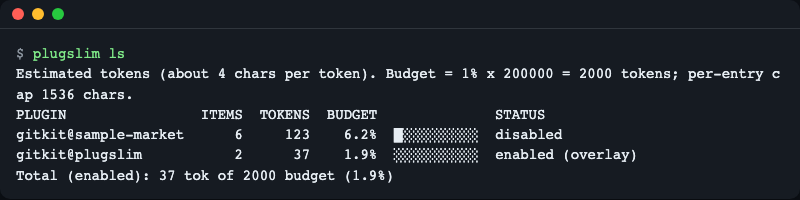
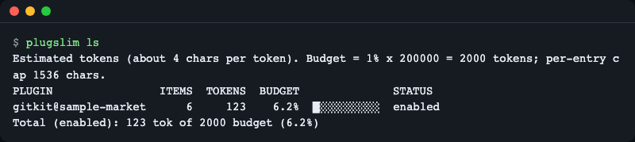
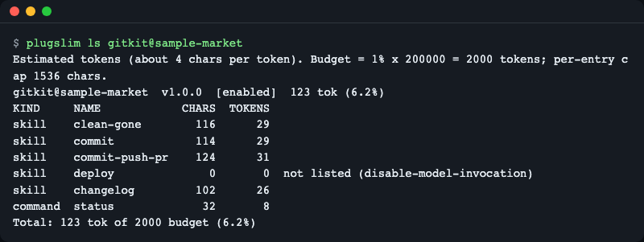
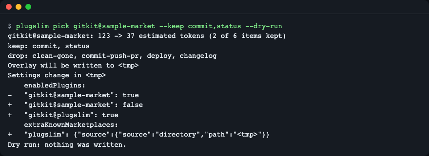
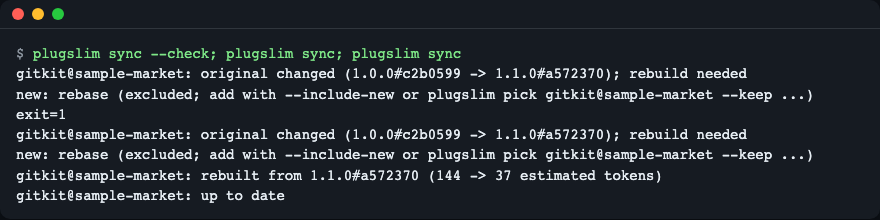
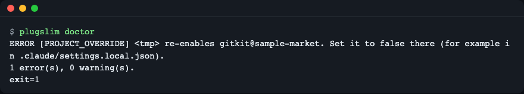
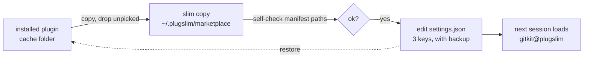

# plugslim

**English** | [한국어](README.ko.md)

Keep only the skills you actually use from a Claude Code plugin, and see the always-on skill-listing token cost as a number. `plugslim pick` builds a slim copy of the plugin and switches to it through the official local-directory marketplace and `enabledPlugins` settings. No runtime patching, and `plugslim restore` undoes it.


*`plugslim ls` after a pick: the original plugin is disabled (123 tok), the slim copy is enabled (37 tok, 1.9% of the listing budget). Numbers come from the practice fixture, not a real plugin.*

## Who is this for

- You installed a plugin with many skills but use two or three of them.
- Your agent keeps invoking a similar-sounding skill from the same plugin.
- You write a plugin and want a CI check that fails when the skill listing gets too expensive.

## Why

Claude Code turns a plugin on or off as a whole. Every enabled skill puts its name and description into the skill listing that is sent with each turn, so unused skills still cost context. The `skillOverrides` setting does not apply to plugin skills (see the [skills docs](https://code.claude.com/docs/en/skills.md), checked 2026-11-15). plugslim works around this with documented features only: a copy of the plugin that contains just the skills you picked.

## Install

Requires Node.js 22 or newer (`brew install node`, or see [nodejs.org](https://nodejs.org/)). On a minimal Linux image you also need `git` (for the GitHub install).

```bash
npm install -g github:LeeGyeongPil/plugslim
```

Or run it once without installing: `npx github:LeeGyeongPil/plugslim ls`.

## Quick start

Try it on the **practice fixture** first. It is a made-up plugin in `examples/sample-home/.claude`, not your real Claude Code config, and every command below only reads it. Clone the repo and install dependencies (the compiled `dist/` is committed, so no build step is needed):

```bash
git clone https://github.com/LeeGyeongPil/plugslim.git && cd plugslim
npm install
```

```console
$ plugslim ls --config-dir examples/sample-home/.claude
Estimated tokens (about 4 chars per token). Budget = 1% x 200000 = 2000 tokens; per-entry cap 1536 chars.
PLUGIN                ITEMS  TOKENS  BUDGET              STATUS
gitkit@sample-market      6     123    6.2%  █░░░░░░░░░  enabled
Total (enabled): 123 tok of 2000 budget (6.2%)
```

(Inside the clone, run the local build as `node dist/bin.js ...` in place of `plugslim ...`.) The plugin costs about 123 tokens every turn. Your own plugins: run `plugslim ls` with no `--config-dir`.


*The plugin table: item count, estimated tokens, share of the budget.*

Then the five-step flow on your own config:

1. In Claude Code, run `/skill-doctor` to see which skills you never use. Leave those out: pass the skills you want to keep to `--keep`, or the flagged ones to `--drop`, using the bare names that `plugslim ls <plugin-id>` lists (needs Claude Code v2.1.252 or later per the official [docs](https://code.claude.com/docs/en/skills.md#find-unused-skills), "Find unused skills", checked 2026-11-16; optional step).
2. `plugslim ls` shows where the tokens go.
3. `plugslim pick <plugin-id> --keep a,b --dry-run` shows what would change. Nothing is written.
4. `plugslim pick <plugin-id> --keep a,b` does it.
5. Start a new session or run `/reload-plugins`.

### Try it safely: `npm run demo`

The demo copies the fixture to a temporary folder, runs ls, pick (dry run and real), doctor and restore, and deletes the folder. It is a practice (mock) mode: nothing touches your real `~/.claude`, and no API key is needed. The real mode differs in one way: it edits your actual settings file (with a backup) and the change only shows up in the next Claude Code session, which this demo cannot start.

```console
$ npm run demo
...
--- summary ---
before:   123 tok (estimated)
after:    37 tok (estimated)
restored: yes (123 tok, settings and overlay back to the original)
```

## Usage

| Command | What it does | Example |
|---|---|---|
| `ls [plugin-id]` | Estimated listing cost per plugin, or per skill for one plugin | `plugslim ls gitkit@sample-market` |
| `ls --json` | Machine-readable output (`plugins[].items[]`, `totalTokens`) | `plugslim ls --json` |
| `ls --path <dir>` | Measure a plugin folder directly (for plugin authors) | `plugslim ls --path . --max-tokens 800` |
| `pick <id> --keep a,b` / `--drop c` | Build the slim copy and switch to it | `plugslim pick gitkit@sample-market --keep commit,status` |
| `pick ... --dry-run` | Print the settings diff and before/after tokens, write nothing | see below |
| `sync [id]` | Re-apply the same pick after the original was updated | `plugslim sync --check` |
| `restore [id \| --all]` | Put the settings keys back and delete the copy | `plugslim restore gitkit@sample-market` |
| `doctor` | Find settings that undo or break a pick | `plugslim doctor --project-dir .` |

Exit codes: `0` ok, `1` findings (doctor error, `--max-tokens` exceeded, `sync --check` needs a rebuild), `2` usage or input error.

### Per-skill cost

```console
$ plugslim ls gitkit@sample-market --config-dir examples/sample-home/.claude
Estimated tokens (about 4 chars per token). Budget = 1% x 200000 = 2000 tokens; per-entry cap 1536 chars.
gitkit@sample-market  v1.0.0  [enabled]  123 tok (6.2%)
KIND     NAME            CHARS  TOKENS
skill    clean-gone        116      29
skill    commit            114      29
skill    commit-push-pr    124      31
skill    deploy              0       0  not listed (disable-model-invocation)
skill    changelog         102      26
command  status             32       8
Total: 123 tok of 2000 budget (6.2%)
```


*One row per skill. A skill with `disable-model-invocation` is not in the listing, so it counts 0.*

### Preview, then pick

```console
$ plugslim pick gitkit@sample-market --keep commit,status --dry-run --config-dir <copy of the fixture> --store-dir <store>
gitkit@sample-market: 123 -> 37 estimated tokens (2 of 6 items kept)
keep: commit, status
drop: clean-gone, commit-push-pr, deploy, changelog
Overlay will be written to <store>/marketplace/plugins/gitkit
Settings change in <config-dir>/settings.json:
    enabledPlugins:
-   "gitkit@sample-market": true
+   "gitkit@sample-market": false
+   "gitkit@plugslim": true
    extraKnownMarketplaces:
+   "plugslim": {"source":{"source":"directory","path":"<store>/marketplace"}}
Dry run: nothing was written.
```


*The dry run prints the exact settings change before anything is written.*

### Follow plugin updates

When the original plugin updates, `sync` rebuilds the copy from the new version and keeps your pick. New skills are left out unless you add `--include-new`.


*`sync --check` exits 1 when a rebuild is needed. The new `rebase` skill is reported as excluded. A second `sync` says "up to date".*

### Check for conflicts


*`doctor` found a project settings file that re-enables the original plugin, which would load both. Its exit code is 1.*

## For plugin authors

Fail CI when the always-on listing gets too big:

```console
$ plugslim ls --path examples/sample-home/.claude/plugins/cache/sample-market/gitkit/1.0.0 --max-tokens 50 --config-dir examples/sample-home/.claude
...
Always-on listing cost 123 tok exceeds --max-tokens 50.
$ echo $?
1
```

## Configuration

| Setting | Meaning | Default |
|---|---|---|
| `--lang en\|ko`, `PLUGSLIM_LANG` | Output language. Order: `--lang`, `PLUGSLIM_LANG`, `LC_ALL`, `LC_MESSAGES`, `LANG`. Anything but Korean falls back to English. | English |
| `--store-dir`, `PLUGSLIM_HOME` | Where the copy, `state.json` and settings backups live | `~/.plugslim` |
| `--config-dir`, `CLAUDE_CONFIG_DIR` | Claude Code config folder (read; only `settings.json` is edited by `pick`/`restore`) | `~/.claude` |
| `--context-window N` | Context window used for the budget | 200000 |
| `--marketplace-name` | Name of the copy marketplace (reserved names are refused) | `plugslim` |

Run it in Korean: `plugslim ls --lang ko` or `PLUGSLIM_LANG=ko plugslim ls`. The screenshots in [README.ko.md](README.ko.md) show the Korean output.

## How it works



1. The installed plugin folder is copied (symlinks are resolved so cache cleanup cannot break the copy), and skills and commands you did not pick are removed.
2. Manifest paths are checked so nothing points at a deleted folder.
3. The copy is registered as a local-directory marketplace named `plugslim`, and only these keys change: `enabledPlugins` for the original and the copy, and `extraKnownMarketplaces.plugslim`. The values before the pick are recorded so `restore` puts back exactly those.
4. Non-skill files such as hooks and scripts are copied unchanged.

### How the numbers are estimated

Each listed item is one line, `- <plugin>:<name>: <description + when_to_use>`, with the text capped at 1536 characters. Tokens are `ceil(chars / 4)`, and the budget is 1% of the context window (2000 for 200000), the defaults in the [settings reference](https://code.claude.com/docs/en/settings-reference.md). These are **estimates**. In one check the official `claude plugin details` reported about 118 tokens for the fixture plugin and about 35 for the slim copy, while plugslim estimated 123 and 37 (checked 2026-11-15, Claude Code 2.1.322).

## When to use it

- Good fit: a plugin you partly use, where you want a smaller, reversible footprint, or a CI number for your own plugin.
- Other tools: to turn off a whole plugin use Claude Code's own `/plugin` menu; for your own (non-plugin) skills use the built-in `skillOverrides` setting ([docs](https://code.claude.com/docs/en/skills.md)).
- Alongside `/skill-doctor`: it shows which skills you use ([docs](https://code.claude.com/docs/en/skills.md)); plugslim then does the trimming, keeping just the skills you choose inside a plugin, whereas the `/plugin` menu above switches a whole plugin on or off.
- Limits: user-scope plugins only for now. `--scope local|project` is planned.

## Troubleshooting

| Symptom | Cause | Fix |
|---|---|---|
| `Cannot parse ...settings.json as JSON` and exit 2 | Invalid JSON in settings | Fix the file; plugslim wrote nothing |
| `ls` says the plugin is still enabled after pick (`ls` also reads the current folder's, or `--project-dir`'s, project and local settings) | A project or local settings file re-enables the original | `plugslim doctor --project-dir .`, then set it to `false` there |
| Skills did not change | The session was already running | Start a new session or run `/reload-plugins` |
| Unknown skill name, exit 2 | Typo in `--keep` | The error lists the available names |
| Tokens differ from Claude Code | plugslim estimates (4 chars per token) | Use them to compare, not as exact values |

Known limits: the real `marketplace add` switch could not be tested in the build sandbox (the copy passes `claude plugin validate`); `--yes` is accepted but there are no prompts.

## Development

```bash
npm install
npm test
npm run compile   # after editing src/, rebuild and commit dist/
```

Bugs and ideas: open an issue. Changes are in [CHANGELOG.md](CHANGELOG.md).

## License

MIT. Runtime dependency: [yaml](https://www.npmjs.com/package/yaml) (ISC).
